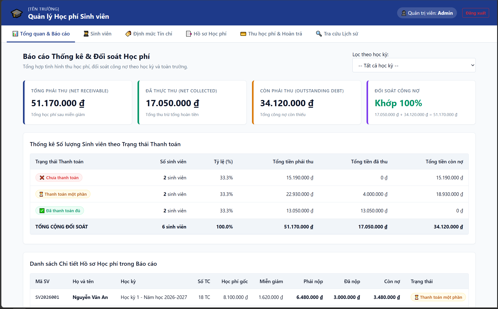
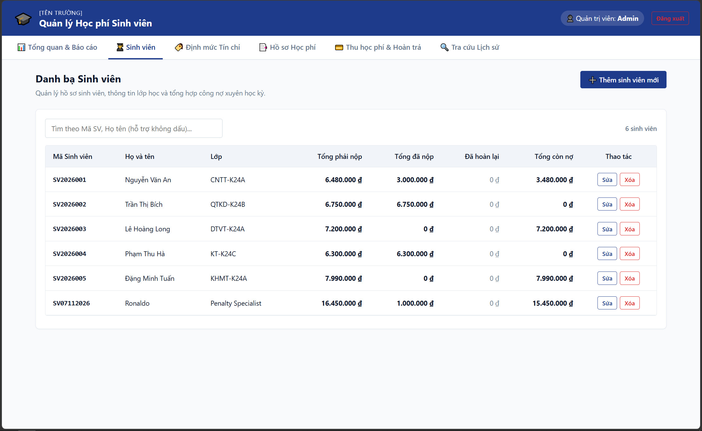
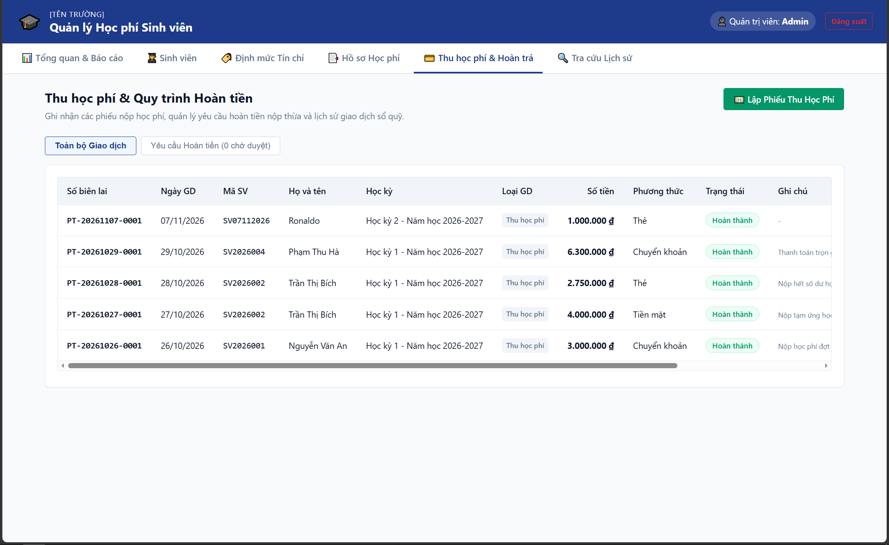

# Hệ thống Quản lý Học phí Sinh viên (Student Tuition Management System)

Ứng dụng Frontend độc lập, hoàn chỉnh để quản lý học phí, định mức tín chỉ, chính sách miễn giảm, thu tiền, quy trình hoàn tiền, đối soát công nợ và in biên lai thu học phí bằng tiếng Việt.

Xây dựng 100% bằng **HTML5, CSS3 và Vanilla JavaScript (ES6+) thuần túy**, không sử dụng framework, không thư viện bên ngoài, không build tool và không cần cài đặt backend.


---

## 1. Cấu trúc Dự án (Project Structure)

```text
bigprojectnew/
├── src/
│   ├── index.html       # Giao diện chính hệ thống
│   ├── styles.css       # Toàn bộ mã định dạng CSS thuần
│   └── app.js           # Mã nguồn điều khiển & tính toán Vanilla JS
├── tests/
│   └── tests.js         # Bộ 28 kịch bản kiểm thử đơn vị tự động
└── README.md            # Tài liệu hướng dẫn sử dụng & tài khoản quản trị
```

---

## 2. Hướng dẫn Chạy Ứng dụng (How to Run)

Ứng dụng chạy trực tiếp trên bất kỳ trình duyệt hiện đại nào (Chrome, Edge, Firefox, Safari):

### Cách 1: Mở trực tiếp tệp HTML
Nhấp đúp chuột vào tệp `src/index.html` để mở trực tiếp trên trình duyệt.

### Cách 2: Chạy qua Web Server cục bộ (Khuyên dùng)
Nếu muốn chạy qua giao thức HTTP tiêu chuẩn:
- **Dùng Node.js / npx:**
  ```bash
  npx serve .
  ```
  Truy cập: `http://localhost:3000/src/index.html`
- **Dùng Python 3:**
  ```bash
  python -m http.server 8000
  ```
  Truy cập: `http://localhost:8000/src/index.html`

---

## 3. Tài khoản Quản trị viên Demo (Demo Credentials)

| Thông tin | Giá trị |
| :--- | :--- |
| **Tên đăng nhập** | `admin` |
| **Mật khẩu** | `admin123` |

> [!WARNING] **Lưu ý Quan trọng về Bảo mật:**
> Tài khoản quản trị này được lưu trữ và kiểm tra hoàn toàn ở phía máy khách (Client-Side) trong tệp `src/app.js`. Cơ chế này chỉ phục vụ mục đích trình diễn và thử nghiệm giao diện, **không cung cấp bảo mật thực tế**. Trong môi trường sản phẩm thực tế, việc xác thực phải được xử lý qua máy chủ an toàn với JWT/Cookie HttpOnly.

---

## 4. Chạy Bộ Kiểm thử Đơn vị (Unit Tests)

Bộ kiểm thử bao gồm hơn 12 nhóm với 28 kịch bản kiểm thử tự động kiểm tra toàn bộ các hàm tính toán, ngưỡng biên số dư, làm tròn, chặn nộp thừa, quy trình hoàn tiền và tìm kiếm tiếng Việt không dấu.

Để chạy bộ kiểm thử, thêm tham số `?test=1` vào thanh địa chỉ trình duyệt:
- Ví dụ: `http://localhost:8000/src/index.html?test=1` hoặc mở tệp `src/index.html?test=1`
- Mở **Developer Tools** (phím `F12` hoặc `Ctrl + Shift + I`) và chọn tab **Console** để xem nhật ký kết quả chi tiết của từng bài kiểm thử.
- Góc dưới màn hình sẽ hiển thị thanh thông báo trạng thái `Unit Tests: Passed`.

---

## 5. Dữ liệu Mẫu Khởi tạo Tự động (Seed Data)

Khi tải ứng dụng lần đầu tiên, hệ thống tự động khởi tạo dữ liệu mẫu vào `localStorage`:
- **5 sinh viên**: `SV2026001` (Nguyễn Văn An), `SV2026002` (Trần Thị Bích), `SV2026003` (Lê Hoàng Long), `SV2026004` (Phạm Thu Hà), `SV2026005` (Đặng Minh Tuấn).
- **2 học kỳ & 3 định mức tín chỉ**:
  - Học kỳ 1 - Năm học 2026-2027: 450.000 ₫ / tín chỉ.
  - Học kỳ 2 - Năm học 2026-2027: 470.000 ₫ / tín chỉ.
  - Học kỳ 1 - Năm học 2027-2028: 500.000 ₫ / tín chỉ.
- **1 hồ sơ miễn giảm**: Sinh viên `SV2026001` được giảm 20% học phí theo diện học bổng khuyến khích loại Giỏi.
- **Các phiếu thanh toán bao phủ đầy đủ 3 trạng thái**:
  - `Chưa thanh toán` (Unpaid): Sinh viên `SV2026003` và `SV2026005`.
  - `Thanh toán một phần` (Partially Paid): Sinh viên `SV2026001` (nợ 6.480.000 ₫, đã nộp 3.000.000 ₫, còn nợ 3.480.000 ₫).
  - `Đã thanh toán đủ` (Fully Paid): Sinh viên `SV2026002` (nộp 2 đợt: 4.000.000 ₫ + 2.750.000 ₫) và `SV2026004` (nộp 6.300.000 ₫).

---

## 6. Các Tính năng Nổi bật & Quy tắc Nghiệp vụ

1. **Bảo toàn Bản chụp Đơn giá (Rate Snapshot)**: Khi chỉnh sửa đơn giá tín chỉ của học kỳ, các hồ sơ học phí đã lập trước đó không bị thay đổi vì mỗi hồ sơ lưu giữ bản chụp đơn giá riêng tại thời điểm lập.
2. **Quy tắc Chặn Nộp Thừa (Overpayment Rule)**: Nếu số tiền nhập vào vượt quá số tiền còn nợ, hệ thống lập tức từ chối và hiển thị thông báo:
   `"Số tiền vượt quá số còn nợ. Vui lòng lập yêu cầu hoàn tiền trước."` Không có dữ liệu nào được ghi nhận.
3. **Quy trình Hoàn tiền Hai bước (Refund Procedure)**: Admin lập yêu cầu hoàn tiền với trạng thái ban đầu `"Chờ duyệt"`. Chỉ khi admin duyệt và xác nhận `"Đã hoàn tiền"`, số tiền thực nộp của sinh viên mới giảm xuống tương ứng.
4. **Bảo toàn Lịch sử (Audit Trail / Reversals)**: Giao dịch thu tiền và hoàn tiền không bao giờ bị xóa. Các sai sót được điều chỉnh thông qua bút toán đảo mục (Reversal Entry) có ghi rõ lý do.
5. **In Biên lai Thu tiền Chuẩn & Đọc số thành chữ**:
   - Sử dụng CSS `@media print` để hiển thị duy nhất mẫu biên lai thu tiền khổ chuẩn khi in, ẩn toàn bộ thanh điều hướng, nút bấm và bảng dữ liệu.
   - Biên lai bao gồm đầy đủ số biên lai tuần tự `PT-YYYYMMDD-XXXX`, ngày thu, mã sinh viên, họ tên, lớp, học kỳ, số tiền thu, số dư nợ còn lại, tên người thu tiền, tên trường và **số tiền viết bằng chữ tiếng Việt** (VD: *Năm triệu bốn trăm nghìn đồng chẵn*).
6. **Tìm kiếm Tiếng Việt Không dấu**: Tìm kiếm sinh viên và lịch sử giao dịch không phân biệt chữ hoa, chữ thường và dấu tiếng Việt (ví dụ: gõ `nguyen` sẽ khớp với `Nguyễn`, gõ `dang` khớp với `Đặng`).
7. **Đối soát Công nợ Tự động**: Hệ thống đối soát công nợ ở mọi học kỳ:
   $$\text{Đã thực thu} + \text{Còn nợ} = \text{Tổng phải thu}$$
   Khoản nộp thừa (nếu có do chỉnh sửa mức miễn giảm sau khi nộp) được tách riêng thành cảnh báo và không tính lẫn vào công nợ phải thu.
8. **Chặn Xóa Sinh viên Có Dữ liệu**: Chặn tuyệt đối hành vi xóa sinh viên đã phát sinh hồ sơ học phí hoặc phiếu thu với thông báo:
   `"Không thể xóa sinh viên đã có dữ liệu học phí."`

## Ảnh chụp giao diện

### Tổng quan & báo cáo



### Sinh viên



### Quản lý chi trả

